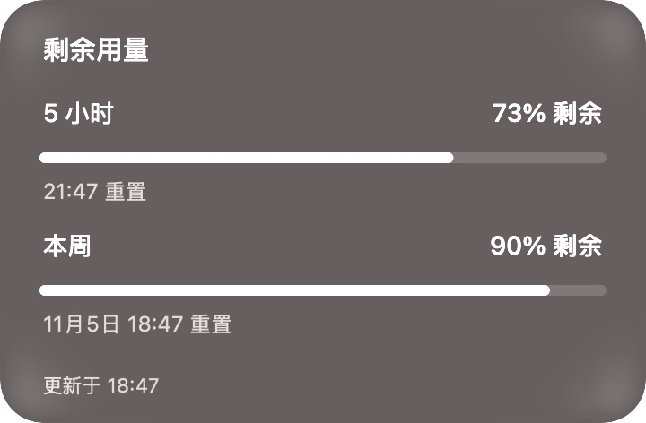
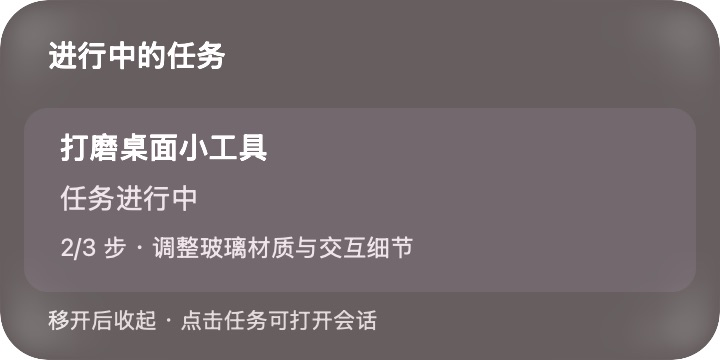

# Codex Glass Companion

[简体中文](README.zh-CN.md) · [Download](https://github.com/tttlc0507/codex-glass-companion/releases) · [Report a bug](https://github.com/tttlc0507/codex-glass-companion/issues/new/choose)

A small floating glass capsule for Codex on macOS. Start a chat, hover to check your remaining five-hour and weekly allowance, and follow local task activity without switching back to the main window.


**Unofficial community project.** Not affiliated with or endorsed by OpenAI or Apple. The current interface is in Simplified Chinese; English UI is a future contribution opportunity.

## What it does

- **Three controls:** new chat, hover for remaining allowance, hover for local tasks. Usage and task controls also work by clicking.
- **Real remaining allowance:** five-hour and weekly progress bars, reset times, and a timestamp when data is stale. These are account limits, not raw token counts or a billing estimate.
- **Quiet status lights:** red while working, yellow for a recorded request for your response, green briefly after completion. Reduced Motion keeps the color static.
- **Glass that fits your desktop:** light, dark, or system appearance; optical icon alignment; rounded material masks; color showing through hover feedback.
- **Follows Codex:** an optional event-driven per-user launch agent opens the capsule with Codex and closes it when Codex quits. Manually quitting the capsule is respected until the next Codex launch.
- **Local task view:** task lifecycle and available plan steps from local Codex records, with a link back to the chat. No invented completion percentage.




*Screenshots use the app's offline demo mode and fictional task/usage data.*

## Quick start

### Requirements

- macOS **14 or newer**. The native Liquid Glass layer needs **macOS 26**; earlier systems use native frosted material. Tested locally on macOS 26.6.2; other versions need community testing.
- Apple Silicon or Intel Mac.
- Python **3.9+**. Python from Xcode Command Line Tools or Homebrew works; no pip packages are needed.
- For live data: a signed-in Codex desktop app or Codex CLI, and local Codex records. Demo mode needs neither a Codex login nor network access.

### Download and run

1. Download the `macos-universal.zip` asset from [Releases](https://github.com/tttlc0507/codex-glass-companion/releases), verify its checksum against `SHA256SUMS`, and extract it.
2. Open `CompanionHover.app`. For the first run of this **ad-hoc signed, not notarized** preview, macOS may require **System Settings → Privacy & Security → Open Anyway**. See [Apple's instructions](https://support.apple.com/en-us/102445). Do not disable Gatekeeper globally.
3. Hover the middle or right control. Right-click the capsule → **外观** to choose **深色玻璃** (dark), **浅色玻璃** (light), or **跟随系统** (system).
4. Optional: in the extracted folder, run `python3 install.py` to install in your user Library and enable launch synchronization. No administrator access is used.

The installed app is under `~/Library/Application Support/CompanionHover/`. Closing a Codex window is different from quitting Codex with ⌘Q.

### Build from source

With the dependencies already installed, these commands build and open the app:

```sh
git clone https://github.com/tttlc0507/codex-glass-companion.git
cd codex-glass-companion
make run
```

If the compiler is missing, install Apple's tools first with `xcode-select --install`. Full Xcode is not required. Building the native Liquid Glass layer requires a macOS 26 SDK; older SDKs compile the frosted fallback.

```sh
make demo       # Offline demo, separate app identity; does not read your Codex data
make test       # Isolated Python + native appearance/geometry checks
make install    # Build and enable follow-Codex startup
make disable    # Disable synchronization, keep the installed app
make uninstall  # Remove the installed app and launch agent, keep preferences
make package    # Universal release ZIP + SHA256SUMS under dist/
```

See [installation and troubleshooting](docs/INSTALL.md) for custom CLI locations and manual startup.

## How it works and what it reads

The AppKit UI starts a local Python bridge. About once per minute the bridge uses the existing Codex CLI's `app-server` interface to read account rate limits; it does not start a model task. About every two seconds it reads the local thread database and incremental rollout records under your Codex home. It excludes subagent threads and displays public task summaries, not reasoning content.

The companion has no telemetry, analytics, credential store, or project-operated server. **The Codex CLI can contact OpenAI to refresh your allowance using its existing login.** Offline demo mode skips the bridge entirely. See [PRIVACY.md](PRIVACY.md) for data access and limitations.

## Compatibility limits

- Local Codex SQLite schemas, rollout events, and `codex://` links can change. Unknown or missing data is shown as unavailable.
- The task view covers up to 60 recent local, non-archived main threads; up to four active cards are shown, prioritizing requests for your response. Browser-only and other-device activity may be absent.
- Yellow light depends on confirmation/input requests recorded in the chat. System permission dialogs not written to those records may not be detected.
- A stale active task is marked as uncertain; green is shown only briefly after an explicit completion, not after cancellation.
- This is an independent desktop tool. It cannot be installed as a functional item in Codex's native Pets list.
- No automatic updates or signed/notarized production distribution yet.

## Project layout

```text
src/                    AppKit capsule, launch watcher, read-only Python bridge
scripts/                Build, package, test and per-user installation commands
tests/                  Synthetic data fixtures and native UI regression checks
docs/images/            Demo-mode screenshots; no personal task records
docs/INSTALL.md         Installation, removal and troubleshooting
.github/                CI, release automation, issue/PR templates, dependency updates
VERSION                 Single release version used by the build
```

Builds, local development history and release archives are excluded from Git. Executables belong in Releases, not the source tree. No Git LFS is needed for the small documentation images.

## Feedback and contributing

If you try it, an issue describing your macOS version, Codex version, and what worked is useful. Feature ideas and focused pull requests are welcome; see [CONTRIBUTING.md](CONTRIBUTING.md). Please keep authentication files and private rollout logs out of public issues. Report sensitive findings using [SECURITY.md](SECURITY.md).

Related projects: [CodexBar](https://github.com/steipete/CodexBar) and [CodexUsage](https://github.com/BrkMen/CodexUsage). Their release, installation and privacy documentation informed this repository's presentation.

## License

[MIT](LICENSE). OpenAI/Codex and Apple/macOS names remain their owners' trademarks. SF Symbols are requested at runtime from macOS; this repository does not redistribute the SF Symbols library. See [THIRD_PARTY_NOTICES.md](THIRD_PARTY_NOTICES.md).
