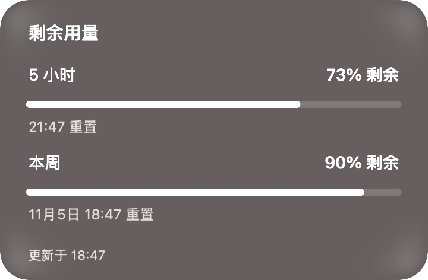

# Codex Glass Companion · 玻璃悬浮助手

[English](README.md) · [下载](https://github.com/tttlc0507/codex-glass-companion/releases) · [反馈问题](https://github.com/tttlc0507/codex-glass-companion/issues/new/choose)

为 macOS 上的 Codex 做的一个小型玻璃悬浮胶囊。用三个按钮开始新聊天、悬停查看五小时与每周剩余额度、查看本机任务进展，减少来回切换窗口。


这是独立的社区项目，与 OpenAI、Apple 没有隶属或背书关系。当前界面为简体中文。

## 功能

- **三个模块**：开始任务、剩余额度、任务进度。后两个支持悬停，也可点击打开。
- **真实剩余额度**：五小时和每周剩余百分比、进度条、重置时间，数据过期时标明时间；不是原始 token 数，也不是费用估算。
- **轻柔状态光**：进行中红色、等待记录中的回复请求为黄色、完成后短暂绿色；支持系统“减少动态效果”。
- **玻璃外观**：浅色、深色、跟随系统，重启后记住选择；悬停反馈能透出环境色光。
- **随 Codex 启停**：可选安装本机事件监听器；手动退出胶囊后，本次不会强制重开。
- **本机任务**：读取实际生命周期和可用的计划步骤，不编造完成百分比。




截图来自离线演示模式，使用虚构的额度和任务，不包含个人会话记录。

## 一分钟开始

### 环境要求

- macOS **14+**，Apple Silicon 或 Intel。macOS **26** 使用原生 Liquid Glass，较早系统使用磨砂材质。已在 macOS 26.6.2 本机验证，其他版本仍需社区测试。
- Python **3.9+**，可来自 Apple Command Line Tools 或 Homebrew，不需要 pip 依赖。
- 读取真实数据需要已登录的 Codex 桌面应用或 CLI，以及本机记录。离线演示不需要登录或联网。

### 下载运行

1. 从 [Releases](https://github.com/tttlc0507/codex-glass-companion/releases) 下载 `macos-universal.zip`，对照 `SHA256SUMS` 校验并解压。
2. 打开 `CompanionHover.app`。当前预览版为临时签名、尚未公证，首次打开可能需要按 [Apple 官方步骤](https://support.apple.com/zh-cn/102445) 在“系统设置 → 隐私与安全性”中选择“仍要打开”。不要全局关闭 Gatekeeper。
3. 悬停中间或右侧按钮。右键胶囊 → **外观**，选择深色、浅色或跟随系统。
4. 希望随 Codex 启动时，在解压目录运行 `python3 install.py`，无需管理员权限。

安装位置为 `~/Library/Application Support/CompanionHover/`。关闭 Codex 的窗口并不等于用 ⌘Q 退出应用。

### 从源码运行

依赖已经安装后，执行：

```sh
git clone https://github.com/tttlc0507/codex-glass-companion.git
cd codex-glass-companion
make run
```

没有编译器时先执行 `xcode-select --install`。无需完整 Xcode；要编译原生 Liquid Glass，需要 macOS 26 SDK，旧 SDK 会编译磨砂兼容效果。

```sh
make demo       # 离线演示，不读取本机 Codex 数据，使用独立应用标识
make test       # 数据和原生外观回归检查
make install    # 安装并随 Codex 启停
make disable    # 关闭联动，保留应用
make uninstall  # 删除安装的应用和联动，保留偏好设置
make package    # 通用架构 ZIP 和校验和，输出到 dist/
```

详细说明见 [安装与排错](docs/INSTALL.md)。

## 数据与隐私

界面为原生 AppKit，数据桥接仅使用 Python 标准库。约每分钟调用本机 Codex CLI 的 `app-server` 读取额度，约每两秒增量读取本机 SQLite 与会话日志。不会启动模型任务；只显示公开任务摘要，不显示推理内容。

没有统计上报、广告、独立服务器，也不自行储存账号凭据。**Codex CLI 可能通过已有登录联系 OpenAI 更新额度**，因此真实额度模式不是完全离线。完整说明见 [PRIVACY.md](PRIVACY.md)。

## 已知边界

- Codex 的数据库、日志格式和深链可能变化，无法读取时显示“暂不可用”。
- 最多检查最近 60 个未归档的本机主会话，显示最多 4 个活动任务，等待回复的任务优先。网页和其他设备上的任务可能不出现。
- 未写入会话记录的系统权限弹窗可能无法触发黄色光。
- 长时间未更新的活动任务显示“状态待确认”；停止不等于完成。
- 这是独立悬浮工具，不能作为带功能的宠物装进原生 Pets 列表。
- 当前没有自动更新，也没有开发者签名与公证。

## 目录与贡献

- `src/`：原生界面、启动监听器、只读数据桥接。
- `scripts/`：构建、安装、打包和测试。
- `tests/`：合成数据测试与原生圆角、外观回归检查。
- `docs/`：演示截图、安装和发布说明。
- `.github/`：持续集成、发布、Issue/PR 模板和依赖更新。

欢迎用 [Issues](https://github.com/tttlc0507/codex-glass-companion/issues) 反馈自己的 macOS 和 Codex 版本、体验或功能建议。贡献方式见 [CONTRIBUTING.md](CONTRIBUTING.md)，隐私问题见 [SECURITY.md](SECURITY.md)。请勿公开粘贴个人认证文件或完整会话日志。

仓库展示参考了 [CodexBar](https://github.com/steipete/CodexBar) 和 [CodexUsage](https://github.com/BrkMen/CodexUsage) 的安装、隐私与发布说明。

源码使用 [MIT 协议](LICENSE)，相关商标及系统图标的权利归原权利人所有，见 [第三方说明](THIRD_PARTY_NOTICES.md)。
